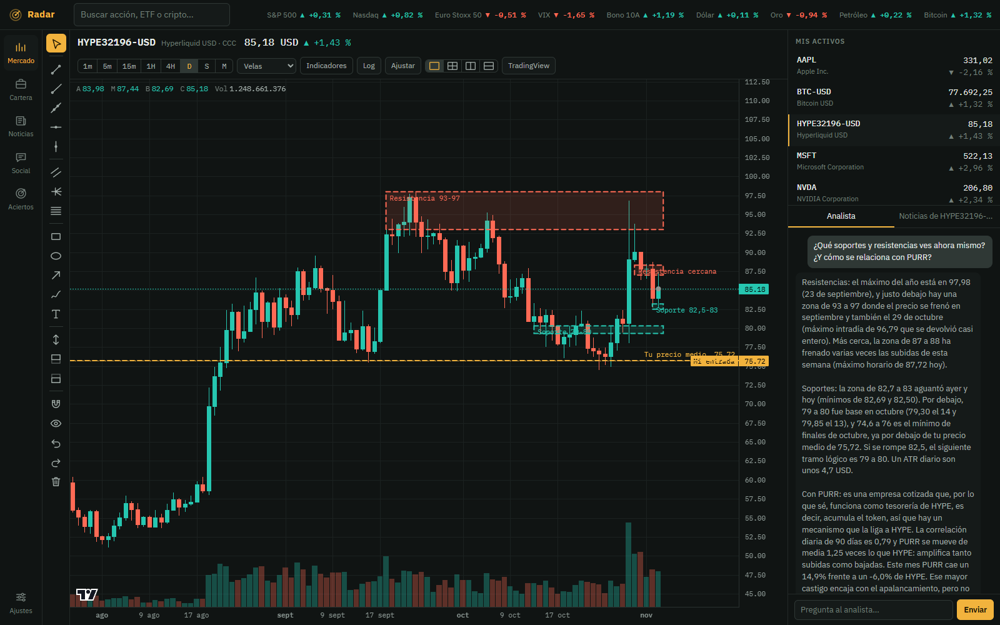
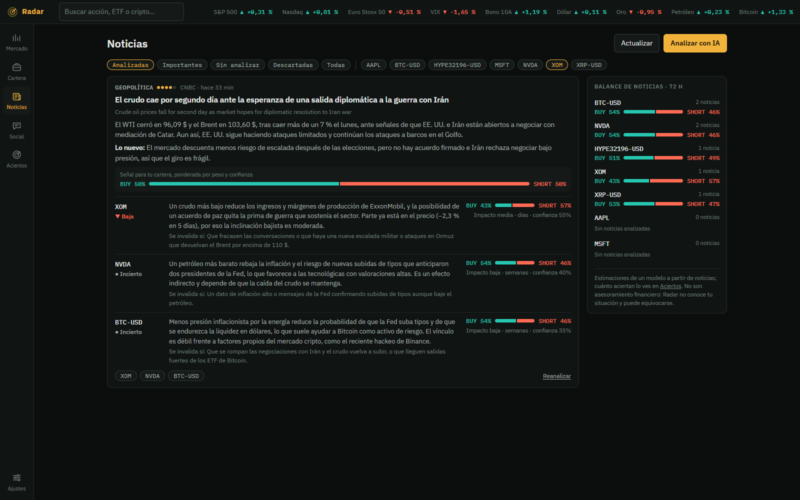
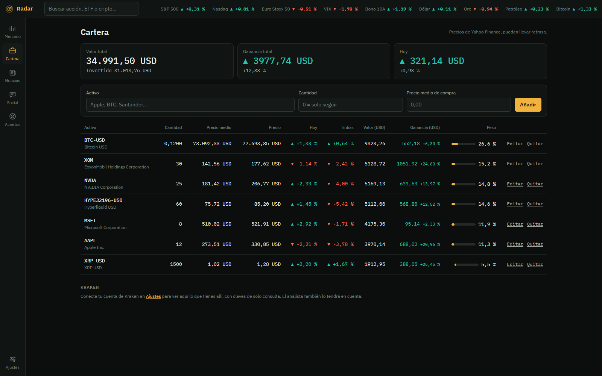
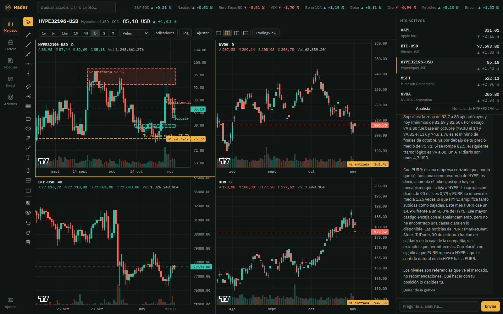

# Radar

A local dashboard for stocks and crypto: charts with drawing tools, a portfolio, news and social feeds, and
an AI analyst (Claude) that links each news item to your holdings through its economic mechanism. It also
measures whether its own signals turn out right.

> **Not financial advice.** Signals are estimates from a language model and have not yet been validated
> against real outcomes. Radar does not know your situation and is not licensed to recommend investments.

The interface and the analyst's answers are in Spanish.



## Features

- **Charts**: up to four at once, from 1 minute to 1 month, with lines, zones, trend lines and text.
- **Portfolio**: positions with average price and P&L, plus optional read-only access to your Kraken account
  (spot and Futures).
- **News and social**: RSS from CNBC, MarketWatch, the Fed, CoinDesk, Cointelegraph, Yahoo and Google News,
  StockTwits and Reddit. Headlines that report the same event are grouped and counted once.
- **News agent**: for every relevant item it explains how it affects each holding (oil prices move an oil
  company even when the headline doesn't name it) and estimates the probability of a rise.
- **Per-asset analyst**: a summary when you open an asset, and a chat. It gets prices, candles, news, related
  assets with their correlation, and your positions. For companies it also gets their financials: valuation
  ratios (EV/sales, EV/EBITDA, P/E…), margins, cash and debt, analyst revenue estimates, and four years plus
  five quarters of history. It can propose levels and draw them on the chart, and you can paste longer
  documents into the chat.
- **Opportunities mode**: a second pass over the news that looks for effects on your watchlist (assets you
  follow with quantity 0) rather than on what you hold: suppliers, customers, competitors, sector and macro.
  The model can only pick symbols from the watchlist, and each idea states what would have to happen for it
  to work. "Stocks to buy" lists never reach the model: Python counts the tickers they cite as sentiment.
- **Alerts**: while Radar is open, a background watcher checks every minute for your price rules, levels drawn
  on the charts, news of importance 4 or 5 about your assets, strong daily moves and upcoming events
  (earnings, Fed decisions, and US CPI, jobs, GDP and PCE with a free FRED key), and notifies you through
  Windows, Telegram or ntfy. Anti-spam limits defer the less urgent ones to a daily digest. It makes no
  model calls.
- **Hit-rate scoreboard**: judges each signal (portfolio and ideas alike) once its horizon ends and reports
  accuracy with a Wilson interval, the Brier score against always saying 50 %, calibration by bands, the
  result against SPY or BTC over the same window, and the result net of a round-trip fee.

## Screenshots

The portfolio in these screenshots is a made-up example.

**News linked to holdings by mechanism**: falling oil prices hit XOM directly and reach NVDA and BTC
through inflation and interest rates.



**Portfolio**



**Up to four charts at once**



## How it works

```
Browser (static/: HTML, CSS and JS, no build step)
        │  /api/...
        ▼
server.py ──► mercado.py    prices and candles from Yahoo Finance
          ──► noticias.py   RSS from news sites, Google News and Reddit
          ──► kraken.py     Kraken account, signed with HMAC-SHA512
          ──► datos.py      SQLite: portfolio, news, analyses, chats
          ──► agente.py     news analysis in batches
          ──► analista.py   summary and chat for each asset
          ──► marcador.py   checks past signals
                 │
                 ▼
          cuenta.py: claude.exe -p (your Claude account)  or  the Anthropic API
```

Design decisions:

- **Python computes, the model explains.** RSI, moving averages, volatility, ATR, correlations and hit rates
  are computed without AI. The model receives the numbers ready-made, so it spends no tokens on them and
  cannot make them up.
- **The model has no tools.** It reads text from the internet, and a web page could hide instructions. Radar
  fetches everything it needs beforehand and passes it in as text; Claude runs with no tools and no MCP.
- **JSON-schema responses.** Every call requires a fixed structure, and the code validates what comes back
  (for example, it drops levels with absurd prices before drawing them).
- **A model per task.** Haiku groups duplicate headlines, Opus analyses news and Sonnet handles the chat.
  They can be changed in Settings.
- **No heavy dependencies.** A standard-library server (`ThreadingHTTPServer`), SQLite and a front end with
  no build step.

## Getting started

Requirements: Python 3.11 or later. Tested on Windows.

```bat
iniciar.bat
```

or, on any system:

```bash
pip install -r requirements.txt
python server.py
```

Then open http://127.0.0.1:8770. Set `RADAR_PUERTO` to use another port.

Tests use only the standard library and never touch the network, Claude or your data:

```bash
python -m unittest discover -s tests -t .
```

The analyst needs one of these, configured in **Ajustes** (Settings):

- **Your Claude account**: Radar uses the official `claude.exe` installed by the Claude desktop app. Sign in
  once with the button in Settings.
- **An Anthropic API key**, billed per use.

Kraken is optional: create a **query-only** key on Kraken (no trading or withdrawal permissions) and paste
it in Settings.

## Privacy

Everything runs on your computer and the server only listens on `127.0.0.1`. Data and keys are stored in
`%LOCALAPPDATA%\Radar` (or the folder in `RADAR_DATOS`), outside the project, and keys are never sent back
to the browser. The only things that leave your machine are the requests to Yahoo, the RSS feeds, Kraken and
Claude.

## Limitations

- Prices come from Yahoo Finance's public but unofficial endpoints, which can change or break. Personal use
  only.
- The agent's signals are not validated: the scoreboard is there to check them over time.
- X (Twitter) needs a paid token and is untested.

## Credits

- Charts: [Lightweight Charts](https://github.com/tradingview/lightweight-charts) by TradingView
  (Apache 2.0).
- Built with the help of [Claude Code](https://claude.com/claude-code). The commit history was
  reconstructed from that session's log: each commit's author date is when that part was written.

## License

[MIT](LICENSE)
